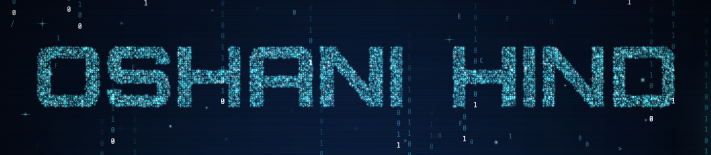
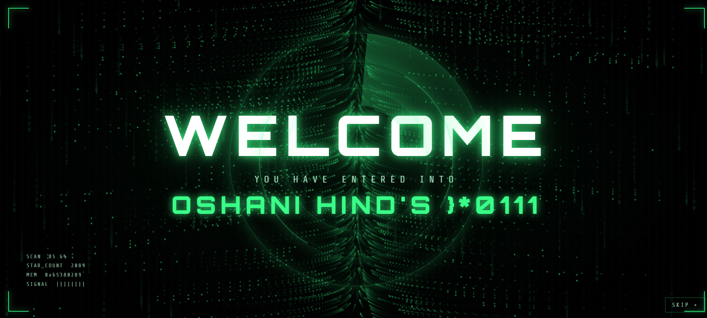
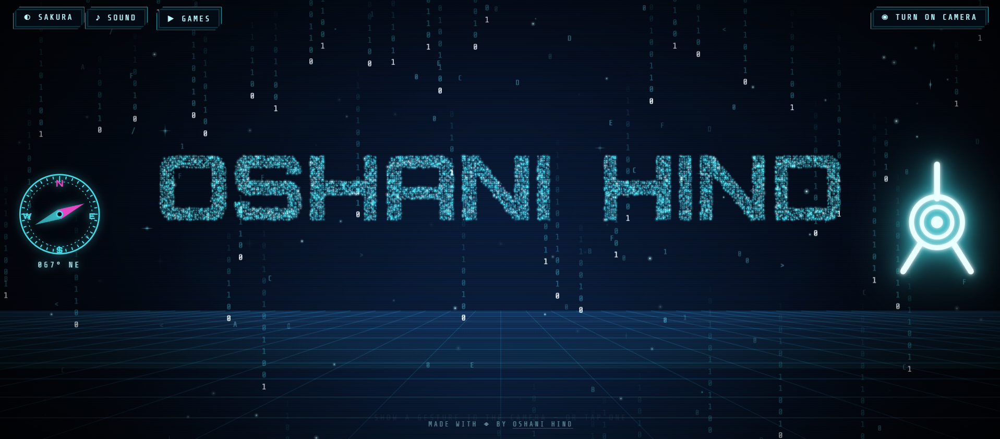
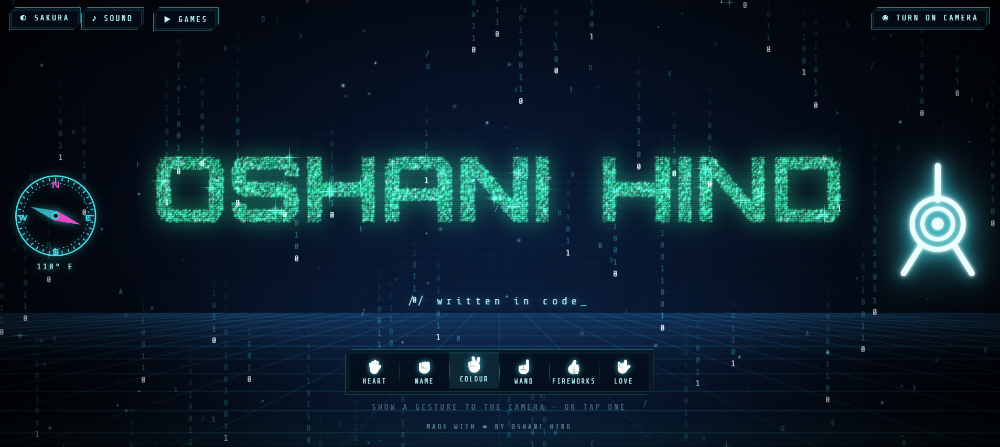
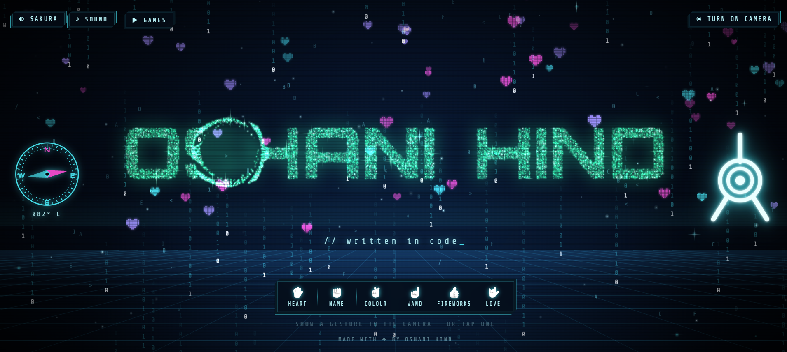
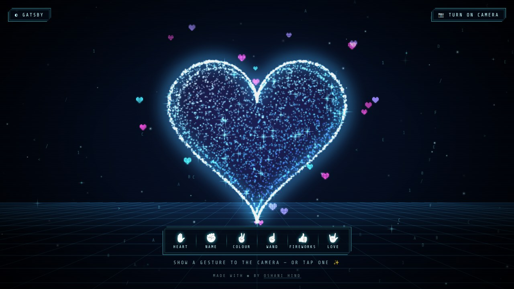
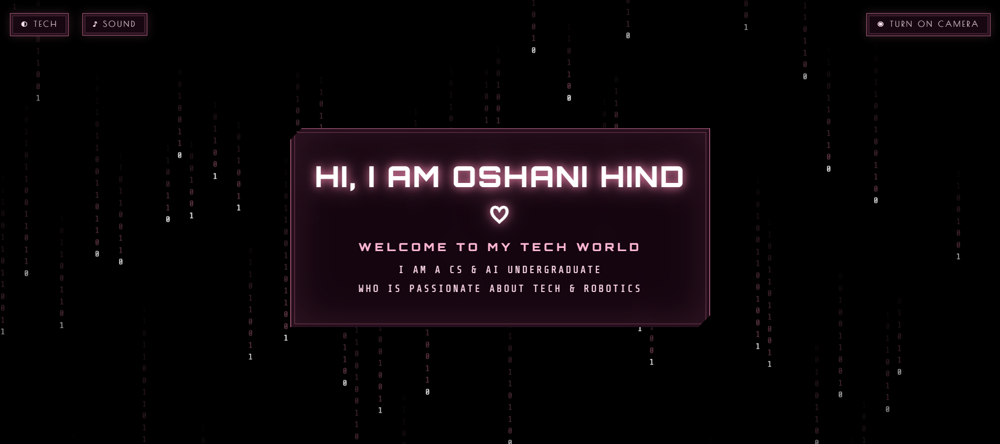
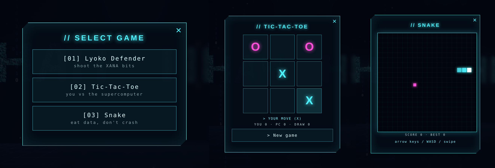
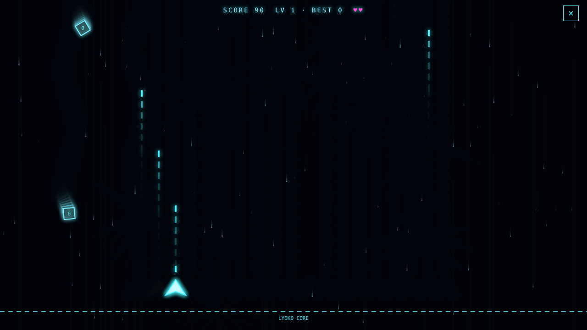

<div align="center">



# Welcome to My Little World

**Stardust Snap** — an interactive web experience where a name is written in glowing stardust and controlled with hand gestures through the webcam.

[Live Demo](https://hindelgiriyage.github.io/WELCOME-TO-MY-little-WorlD/) · [Report an Issue](https://github.com/HINDELGIRIYAGE/WELCOME-TO-MY-little-WorlD/issues)


</div>

---

## Preview

### Intro
A boot terminal, a scanner beam and a glitch-style welcome screen.



### Stardust name
About 2,000 glowing particles swirl in from deep space and form the name, with a HUD compass, a moving grid floor and binary rain.



### Gestures in action

| Colour change (peace sign) | Love rain (love sign) |
|:---:|:---:|
|  |  |

| Heart (open hand) | Sakura theme |
|:---:|:---:|
|  |  |

### Mini games
A built-in game module with three games: Defender, Tic-Tac-Toe against the computer, and Snake.





---

## Features

- **Hand gesture control** — real-time webcam hand tracking with MediaPipe Hand Landmarker and a live skeleton preview
- **Particle system** — the name is sampled from a hidden canvas and every point becomes a spring-driven particle
- **Heart animation** — shockwave, flash and a heartbeat (*lub-dub*) built from the parametric heart curve
- **Two themes** — neon *Tech* and pink *Sakura*, switchable at any time
- **Mini games** — Defender (space shooter), Tic-Tac-Toe with a minimax AI, and Snake, with best scores saved locally
- **HUD compass** — follows the cursor on desktop and the real device heading on phones
- **Synthesised sound** — all sound effects are generated with the Web Audio API, no audio files
- **Responsive** — layout and name wrapping adapt to phones and tablets
- **Works without a camera** — every effect is also available from the on-screen buttons and keyboard

## Controls

| Gesture | Key | Effect |
|---|:---:|---|
| Open hand | `1` | The name explodes into a beating heart |
| Fist | `2` | The stardust gathers back into the name |
| Peace sign | `3` | Changes the colour of the name |
| Pointing finger | `4` | Magic wand — sparkles follow the fingertip |
| Thumbs up | `5` | Fireworks |
| Love sign | `6` | A rain of small hearts |

| Key | Action |
|:---:|---|
| `T` | Switch theme |
| `M` | Toggle sound |
| `Enter` / `Esc` | Skip the intro, close a game |

URL options: `?name=YourName` changes the name, `?theme=deco` starts in the Sakura theme, `?intro=0` skips the intro.

## Tech Stack

| Technology | Purpose |
|---|---|
| HTML5 | Page structure |
| CSS3 | Layout, glass UI, transitions and keyframe animations |
| JavaScript (Canvas 2D) | Particle system, backgrounds, heart curve and games |
| Web Audio API | Sound effects |
| [MediaPipe Tasks Vision](https://ai.google.dev/edge/mediapipe/solutions/vision/hand_landmarker) | Hand landmark detection |
| Google Fonts | Orbitron, Share Tech Mono, Great Vibes, Poiret One |

## Getting Started

The webcam only works over `https://` or on `localhost`, so run the project with a local server.

```bash
git clone https://github.com/HINDELGIRIYAGE/WELCOME-TO-MY-little-WorlD.git
cd WELCOME-TO-MY-little-WorlD
python -m http.server 8000
```

Then open `http://localhost:8000`. In VS Code, the **Live Server** extension works as well.

## Project Structure

```
├── index.html             Page markup
├── css/
│   └── style.css          All styles
├── js/
│   ├── intro.js           Boot, scanner and welcome intro
│   ├── main.js            Particle universe, stardust name and heart
│   ├── hand-tracking.js   Webcam, MediaPipe and gesture detection
│   ├── sound.js           Synthesised sound effects
│   ├── compass.js         HUD compass
│   ├── game.js            Defender game
│   └── minigames.js       Games menu, Tic-Tac-Toe and Snake
└── assets/                Screenshots
```

## How It Works

1. **Text to particles** — the name is drawn on an off-screen canvas; each filled pixel on a sampling grid becomes a particle target.
2. **Spring physics** — every particle accelerates towards its target and is damped by friction, producing the gathering motion.
3. **Heart shape** — on snap, particles receive new targets from the heart curve
   `x = 16 sin³t`, `y = 13 cos t − 5 cos 2t − 2 cos 3t − cos 4t`.
4. **Gesture detection** — MediaPipe returns 21 hand landmarks. A finger counts as open when its tip is farther from the wrist than its middle joint, and the pattern of open fingers defines the gesture. A gesture must be held for several frames before it fires, which prevents accidental triggers.

## Customisation

Edit `CONFIG` in `js/main.js` to change the default name and theme:

```js
const CONFIG = {
  name: 'Oshani Hind',
  theme: 'tech',          // 'tech' or 'deco' (Sakura)
};
```

## Author

**Oshani Hind De Silva**
BSc Computer Science & Artificial Intelligence — NIBM
[GitHub](https://github.com/HINDELGIRIYAGE)

## License

Copyright © 2026 Oshani Hind De Silva. All rights reserved.

This repository is shared publicly for viewing and portfolio purposes only. No permission is granted to copy, modify, distribute or use any part of this code or its assets without prior written permission from the author.
